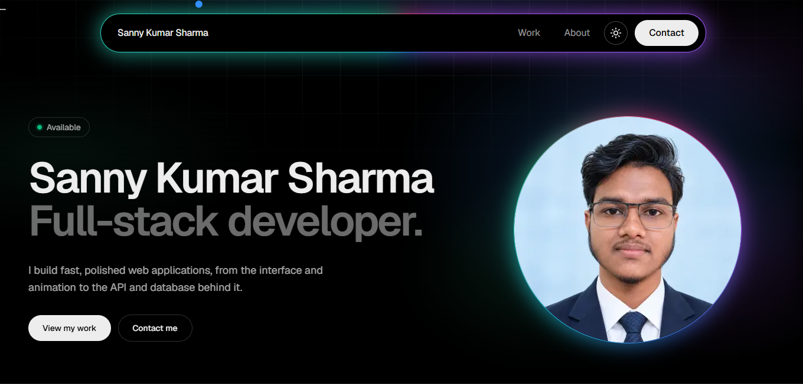

# Sanny Kumar Sharma - Portfolio

My personal portfolio: a fast, responsive site with smooth scrolling, scroll-driven animation and a light and dark theme. I designed and built it from scratch, from the layout and motion to the deployment.

Live site: https://sanny-kumar.vercel.app

## Preview

  

  

## Highlights

- Smooth, scroll-driven motion built with Lenis and GSAP (ScrollTrigger and SplitText), with Framer Motion for the tech stack trains and the project showcase.
- Pinned project showcase on desktop: vertical scroll moves the project cards sideways. On mobile it becomes a simple stacked list.
- Tech stack trains: rows of technologies that glide along and speed up with scroll, grouped into Frontend, Animation and 3D, Backend, and Data and DevOps.
- Light and dark theme with a saved preference and no flash on load.
- Animated navbar with a glowing colourful border, a hamburger menu on mobile, and a custom cursor on devices with a mouse.
- Responsive layout for phones, tablets and desktops.
- Accessibility in mind: reduced motion is respected, interactive elements are keyboard focusable, and images have alt text.
- SEO ready: page metadata, generated Open Graph image and icon, sitemap, robots.txt and JSON-LD structured data.
- Content lives in plain data files, so updating projects or text never means touching components.

## Tech stack

| Area | Tools |
| --- | --- |
| Framework | Next.js 16 (App Router, Turbopack), React, TypeScript |
| Styling | Tailwind CSS v4, Geist font through next/font |
| Animation | GSAP (ScrollTrigger, SplitText), Lenis, Framer Motion |
| Icons | react-icons, lucide-react |
| Deployment | Vercel |

## Project structure

portfolio/
├── public/images/          portrait and project screenshots
└── src/
    ├── app/                layout, page, metadata, OG image, sitemap, robots
    ├── components/
    │   ├── layout/         Nav, Cursor, Intro, SmoothScroll
    │   ├── sections/       Hero, Work, About, Stack, Contact
    │   ├── ui/             ProjectCard, Train, SocialLinks, ThemeToggle
    │   └── seo/            JSON-LD structured data
    ├── data/               projects, about, tech stack, site info
    ├── hooks/              useSpotlight
    └── lib/                GSAP setup, Lenis helper, intro signal

## Getting started

You need Node.js 20.9 or newer.

git clone https://github.com/Sannny007/portfolio.git
cd portfolio/portfolio
npm install
npm run dev

Then open http://localhost:3000.

Other scripts:

npm run build   # production build, also type-checks
npm start       # run the production build
npm run lint    # lint the code

## Environment variables

Create a file named `.env.local` inside the `portfolio` app folder:

NEXT_PUBLIC_SITE_URL=http://localhost:3000

On Vercel, set it to the live URL (for example https://sanny-kumar.vercel.app) and redeploy. It is used for the canonical URL, the sitemap and the social preview image.

## Editing the content

| What | File |
| --- | --- |
| Projects: title, description, stack, screenshot, source link | src/data/projects.ts |
| About text, education, what I am learning | src/data/about.ts |
| Tech stack groups | src/data/stack.ts |
| Name, email, social links, time zone | src/data/site.ts |
| Portrait and project screenshots | public/images/ |

## Deployment

The site is deployed on Vercel and connected to this repository. The Next.js app lives in the `portfolio` subfolder, so the project's Root Directory on Vercel is set to `portfolio`. Every push to the `master` branch triggers a new production deployment.

## Contact

- GitHub: https://github.com/Sannny007
- LinkedIn: https://www.linkedin.com/in/sanny-kumar-sharma-2a8b7540a/
- Email: sanny433sharma@gmail.com